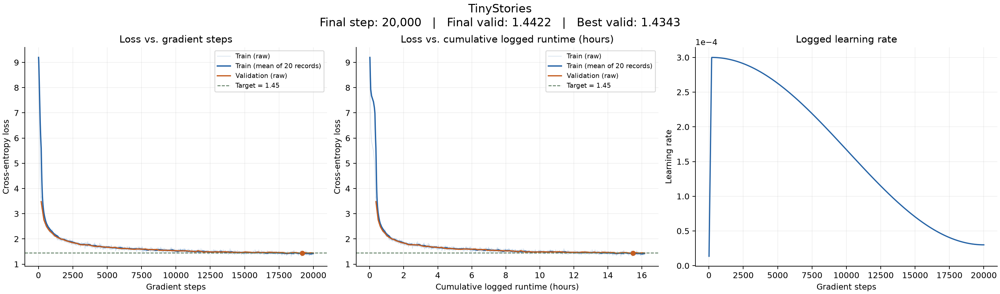
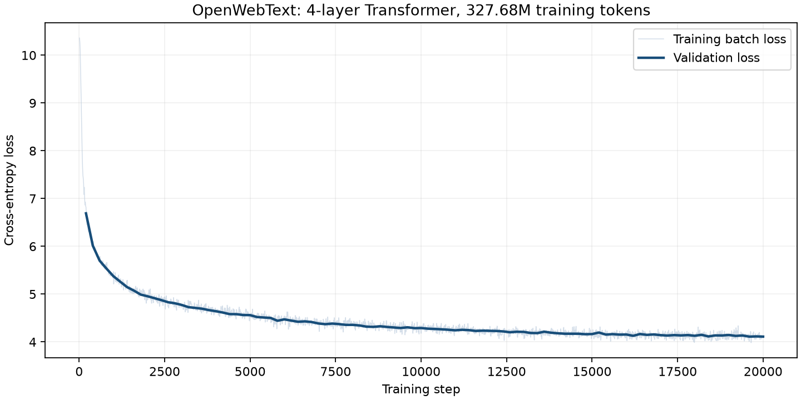

# CS336 Assignment 1 训练证据

整理日期：2026-10-25。本目录只整理已有资料；本次没有修改课程实现、重新训练、生成文本、加载检查点或运行测试。原始配置和 CSV 按字节复制，保留原始精度。已有曲线保持原样。

## 主要结果与证据入口

以下 loss 均筛选原始 `metrics.csv` 的 `split=valid`，不使用 `split=train`。CSV 行号包含表头（第 1 行）。“最低”仅指已记录验证点中的最低值，不代表未记录步骤或完整验证集上的最优值。

| 数据集 / 段落 | 最后验证 loss | step / CSV 行 | 最低验证 loss | step / CSV 行 | 原始文件 |
| --- | --- | --- | --- | --- | --- |
| TinyStories 恢复前 | 1.4822289884090423 | 15000 / 1576 | 1.4587804675102234 | 14800 / 1555 | [T1 metrics.csv](tinystories/tinystories_20260917_092722_139462/metrics.csv)，字段 `step,split,loss` |
| TinyStories 恢复后；也是整条训练链的最终 / 最低值 | 1.442178303003311 | 20000 / 526 | 1.4342574894428253 | 19200 / 442 | [T2 metrics.csv](tinystories/tinystories_20260918_080507_208128/metrics.csv)，字段 `step,split,loss` |
| OpenWebText | 4.111621332168579 | 20000 / 2101 | 4.110878658294678 | 19600 / 2059 | [O1 metrics.csv](openwebtext/owt_full_20260919_010610/metrics.csv)，字段 `step,split,loss` |

便于机器核对的逐段统计见 [analysis_summary.json](analysis_summary.json)：`runs[].last_validation`、`best_validation` 保留 CSV 原始数值字符串和 `csv_line`。这是本次读取已有日志后生成的索引，不是新的训练记录。

## 定位与来源

实际 Git 项目：`E:\cs336\assignment1-basics`。原始训练资料：`E:\cs336\saves\runs`。已有 OWT 审计资料：`E:\cs336\output\owt_model_audit` 和 `E:\cs336\output\audit_owt_checkpoint.py`。

本地 `origin` 是课程上游 `git@github.com:stanford-cs336/assignment1-basics.git`；个人目标仓库的远程名是 `github`，地址为 [SZUtwistzz/cs336_assignment1](https://github.com/SZUtwistzz/cs336_assignment1)。整理时工作区干净，起点为 `6113a6c9ffcb78bf07b04c1e017b77eb7d60fb80`。这个 SHA 仅标识整理时查阅的代码，**不是已确认的训练版本**。训练配置、指标及审计结果中未找到训练 Git commit。

2026-10-25 上传前，通过已登录账号读取 GitHub 仓库 API，确认目标 `full_name=SZUtwistzz/cs336_assignment1`、`private=true`、`visibility=private`、`permissions.push=true`。本任务使用独立证据分支，不改变仓库可见性。

[source_manifest.json](source_manifest.json) 为 20 个既有资料副本记录原始绝对路径、源文件字节数、SHA-256、创建 / 修改时间（UTC）、副本 SHA-256 和处理方式。哈希证明本次收集时副本与源文件的关系，不构成训练时的可信时间戳或来源认证。

未访问其他服务器。OWT 的文件虽位于 Windows 本机，其原始配置 `train_path`、`valid_path`、`run_dir` 使用 `/mnt/data/home/ysy0414/...` Linux 路径。现有证据不能确认 OWT 实际训练主机、操作系统或 GPU 型号，不能将“本机存有资料”写成“在本机 Windows 完成训练”。TinyStories 配置记录的是 `E:\cs336\...` Windows 路径，也未保存主机名 / GPU 型号。

## 运行名称与模型配置

本说明使用以下别名；每段配置均独立保存。

| 别名 | 数据集 | 原始运行目录名 | 配置 |
| --- | --- | --- | --- |
| T1 | TinyStories | `tinystories_20260917_092722_139462` | [config.json](tinystories/tinystories_20260917_092722_139462/config.json) |
| T2 | TinyStories | `tinystories_20260918_080507_208128` | [config.json](tinystories/tinystories_20260918_080507_208128/config.json) |
| O1 | OpenWebText | `owt_full_20260919_010610` | [config.json](openwebtext/owt_full_20260919_010610/config.json) |

| 项目 | T1 / T2 | O1 | 文件字段 |
| --- | --- | --- | --- |
| 词表大小 | 10000 | 32000 | 各 `config.json:vocab_size` |
| 层数 | 4 | 4 | `num_layers` |
| 隐藏维度 | 512 | 512 | `d_model` |
| 注意力头数 | 16 | 16 | `num_heads` |
| 前馈层维度 | 1344 | 1344 | `d_ff` |
| 上下文长度 | 256 | 256 | `context_length` |
| batch size | 64 | 64 | `batch_size` |
| 最大学习率 / 最小学习率 | 0.0003 / 0.00003 | 0.0003 / 0.00003 | `max_lr,min_lr` |
| warmup / 调度终点 | 200 / 20000 | 200 / 20000 | `warmup_steps,cosine_end_step` |
| 最后记录的实际学习率 | T1：7.031615722506e-05；T2：3.0000001699312058e-05 | 3.0000001699312058e-05 | 各 `metrics.csv` 最后 `split=valid` 行的 `lr` |
| 配置计划步数 | 20000 | 20000 | `num_steps`；是否达到另外由指标确认 |
| seed | 42 | 42 | `seed` |
| 设备 / 模型 dtype / 数据 dtype | cuda / float32 / uint16 | cuda / float32 / uint16 | `device,dtype,data_dtype`；不是 GPU 型号证明 |
| 日志间隔 / 验证间隔 / 验证 batch 数 | 10 / 200 / 20 | 10 / 200 / 20 | `log_every,eval_every,eval_batches` |

T1/T2 的数据路径分别指向 `tinystories_train_tokens.bin`、`tinystories_valid_tokens.bin`；O1 指向 `openwebtext_train_tokens.bin`、`openwebtext_valid_tokens.bin`（各配置 `train_path,valid_path`）。本次未读取或上传这些数据文件，也未重新验证其数据版本或哈希。

## TinyStories 恢复关系与日志覆盖

T2 的 `config.json:resume` 明确指向 T1 的 `checkpoints/step_15000.pt`，且 `start_step=15000`、`elapsed_seconds_scope=current_session`。检查点只作为配置中的路径引用保留，文件本体未归档。

| 段落 | train 日志覆盖 | valid 日志覆盖 | 行数，不含表头 |
| --- | --- | --- | --- |
| T1 | 10–15000，每 10 步一条 | 200–15000，每 200 步一条 | 1500 train + 75 valid = 1575 |
| T2 | 15010–20000，每 10 步一条 | 15200–20000，每 200 步一条 | 500 train + 25 valid = 525 |

依据：各段 `metrics.csv:step,split` 与 `config.json:log_every,eval_every`。两段合计 2100 行；同一 `split` 内无重复 step，跨段无重复 step，按配置间隔没有缺失的应记录点。`train` 和 `valid` 在同一个 step 各有一条属于正常情况。1–9、15001–15009 等未单独写日志的步骤不能当作缺失训练，也不能补造逐步 loss。

T1 配置没有 `resume` / `start_step` 字段；根据其最早日志和 T2 的恢复引用，将其标为当前可见训练链的第一段。T1 的 `num_steps=20000` 只是计划；日志只证明它记录到 15000。中断原因、确切停机间隔，以及恢复是否精确复现随机数状态，未找到本次运行专属记录。

另保留 [tinystories_20260916_235145_359599](tinystories/tinystories_20260916_235145_359599/config.json) 的独立早期尝试：只有 19 条 `split=train`，step 10–190，最后训练 loss 为 `3.6864027976989746`（其 [metrics.csv](tinystories/tinystories_20260916_235145_359599/metrics.csv) 第 20 行）。**没有验证记录**。T2 的恢复路径没有指向它，因此不把它拼入正式训练链，也不累加到正式步数。

## OpenWebText 日志覆盖

O1 的 `config.json` 记录 `resume=null`、`start_step=0`。其 `metrics.csv` 包含 2000 条 train（10–20000，间隔 10）和 100 条 valid（200–20000，间隔 200），共 2100 行；没有重复的 `(split,step)`，按配置间隔没有缺失的应记录点。未找到其他关联恢复段。依据是该配置及 CSV，并非服务器说明中的示例命令。

## 验证 loss 的含义

原始配置确认两组正式训练均为 `eval_batches=20,batch_size=64,context_length=256`。现有实现中，[training_together.py](../../cs336_basics/train_LM/training_together.py) 第 218–244 行循环抽取验证 batch 并将 20 个 batch loss 求平均；[data_loader.py](../../cs336_basics/train_LM/data_loader.py) 使用 `np.random.randint` 随机抽取起点；[cross_entropy.py](../../cs336_basics/train_LM/cross_entropy.py) 对 batch 内 token 的交叉熵求均值。旧提交 `70c5edd`、`4cc0c53` 中也能查到相同的验证抽样与平均方式。

据配置与可查实现，合理解释是每次验证抽取 `20 × 64 × 256 = 327680` 个 token 位置后平均，各窗口可能重叠；**不是遍历完整验证集**。由于运行没有记录训练 commit，这属于“配置 + 现有 / 历史代码支持的计算口径”，不能声称已逐字确认实际运行时源码。`split=train` 则是记录点对应训练 batch 的 loss，不是区间平均验证 loss。

## 时间、参数量与工作量

所有目录名中的时间都没有记录时区。下表的时间文本仅来自目录名，不把当前 Windows 时区或整理日期套用到历史训练。

| 段落 | 目录名中的时间文本（时区未知） | 原始配置最后修改时间 UTC | 原始指标最后修改时间 UTC |
| --- | --- | --- | --- |
| T1 | 2026-09-17 09:27:22.139462 | 2026-09-17T01:27:22.2740314Z | 2026-09-17T13:55:34.6598346Z |
| T2 | 2026-09-18 08:05:07.208128 | 2026-09-18T00:05:09.5981344Z | 2026-09-18T03:47:02.6218037Z |
| O1 | 2026-09-19 01:06:10 | 2026-09-19T02:48:41.0438698Z | 2026-09-19T02:48:41.0579977Z |

来源：目录名称与 `source_manifest.json:files[].source_last_write_time_utc`。文件时间可能因复制或修改而变化，只是当前可见文件元数据。尤其 O1 配置和指标修改时间相隔约 0.014 秒，不能当作其训练起止时间。三段均没有保存带时区的训练开始 / 结束事件；精确墙钟起止和停机时间未知。

| 可核对量 | 结果 | 依据与限制 |
| --- | --- | --- |
| T1 最后记录进程耗时 | 44890.9692975 秒 | T1 CSV 第 1576 行 `elapsed_seconds` |
| T2 最后记录进程耗时 | 13313.023244 秒 | T2 CSV 第 526 行 `elapsed_seconds`，该段独立计时 |
| TinyStories 两段日志计时之和 | 58203.9925415 秒，约 16.167776 小时 | 上两项相加；不含离线间隔、未记录的启动 / 最后保存开销，不是纯 GPU 时间 |
| O1 最后记录进程耗时 | 8897.81922581885 秒，约 2.471616 小时 | O1 CSV 第 2101 行 `elapsed_seconds`；同样不等于完整墙钟耗时 |
| 两组各自的名义训练 token 位置数 | 各 327680000 | `20000 × batch_size(64) × context_length(256)`；TinyStories 恢复后只新增 5000 步，不能重复计算前 15000 步。是抽样处理位置数，不是不同 token 数或语料总量，不含验证 |
| TinyStories 实际训练模型参数量 | 未确认 | config 不包含参数总数；不以当前模型初始化结果代替训练检查点事实 |
| OWT 参数量 | 旧审计记录为 45224448 | [audit.redacted.json](openwebtext/owt_full_20260919_010610/existing_audit/audit.redacted.json) 的 `checkpoint.parameters`；旧审计源码用 `sum(p.numel() for p in model.parameters())` 得到。本次未加载权重复核，不作为新实测 |
| 纯训练吞吐量、GPU 型号、显存峰值 | 未确认 | 无独立性能记录；不由含验证 / 保存开销的日志时间声称 GPU 基准性能 |

## 已有曲线、审计与生成文本

TinyStories 的 [plots/summary.json](tinystories/tinystories_20260918_080507_208128/plots/summary.json)、[merged_metrics.csv](tinystories/tinystories_20260918_080507_208128/plots/merged_metrics.csv) 和三张图形文件是本次整理前已存在的派生资料。此次保留原件，没有重画、修改 loss 或重新拼接 CSV。原始两段 CSV 是主要依据。已有合并文件把 T1 最后验证时间 `44890.9692975` 加到 T2 的时间上，保留两段的 loss / lr；浮点序列化可能产生极小末位时间差。核对确认其 2100 个 `(split,step)`、loss、lr 与原始两段对应，时间偏差小于 `1e-7` 秒。

已有总览图将 train 画为原始值和最近 20 条记录的平滑线；valid 使用原值，`Target=1.45` 只是图中参考线，不是新实验。已有后半程验证图缩小了坐标范围。`summary.json` 的 `final_validation`、`best_validation` 与本说明的原始 CSV 结果一致。



OWT 的 [loss_curve.png](openwebtext/owt_full_20260919_010610/existing_audit/loss_curve.png) 和 [audit.redacted.json](openwebtext/owt_full_20260919_010610/existing_audit/audit.redacted.json) 来自已有 `output/owt_model_audit`。审计结果没有内嵌运行目录；其 `training` 数值与 O1 原始 CSV 对应，且同目录外保存的 [audit_owt_checkpoint.py.txt](openwebtext/owt_full_20260919_010610/existing_audit/audit_owt_checkpoint.py.txt) 明确读取 O1 的 `checkpoints/step_20000.pt`。这提供关联依据，但没有训练时签名、权重哈希或训练 commit。源码副本只供核对，没有执行。



旧审计还记录 `recomputed_valid_loss.mean=4.131719619035721`、`batch_std=0.15773612289991304`、`tokens=32768`。根据旧审计源码，这来自 seed `20260919` 下 16 个 batch、每 batch 8 个长度 256 的窗口。它是另一次较小抽样评估，不能替换训练日志的最终验证 loss `4.111621332168579`。`recomputed_train_loss.mean=4.115695878863335` 是训练数据抽样结果，也不能写成验证结果。

原有 4 条生成文本完整保留在审计副本 `generations[0..3].text`，没有截取较好部分或改写文本。共同记录 `top_p=0.9,seed=42`；`checkpoint.iteration=20000`。旧源码指明最大新生成 token 数为 128；JSON 本身没有 `max_new_tokens` 字段，因此这个参数仅由旧源码支持。

| JSON 下标 | 原有 prompt | temperature | prompt_token_count |
| --- | --- | --- | --- |
| 0 | Artificial intelligence is | 0.8 | 4 |
| 1 | Artificial intelligence is | 0.6 | 4 |
| 2 | The government announced | 0.8 | 3 |
| 3 | 请解释什么是人工智能。 | 0.8 | 29 |

依据为各 `generations[i].prompt,temperature,top_p,seed,prompt_token_count,text`。旧结果中可见重复和语义不连贯，中文提示也没有形成可靠的中文回答；这些样例不支持“高质量通用问答”或“中文能力达标”等结论。

TinyStories **未找到已有生成文本样例**。当前仓库的 [generate.py](../../cs336_basics/train_LM/generate.py) 虽配置 step 20000、temperature 0.8、top-p 0.9、最大新 token 512，且使用交互式 prompt，但这只证明脚本内容，不能证明运行过，更不能据此补出 prompt 或文本。

## 已有测试记录与旧文档的边界

- [existing_checks/pytest_20261025_prior_chat.txt](existing_checks/pytest_20261025_prior_chat.txt) 是本次整理请求之前、同一聊天中已有终端工具输出的摘录，记录 6 项测试通过（41.74 秒）。它不是这次重新运行的结果，也不是磁盘上发现的原始完整测试日志；日期来自先前上传任务的记录，没有独立开始时间戳。不能据此声称全套课程测试通过或训练版本通过测试。
- 另保留 `integration_20260916_01` 与 `gpu_integration_20260916_01` 两个已有的 2 步 CPU / CUDA 集成运行配置和指标（各 2 条 train、2 条 valid）。这些短记录不属于正式训练结果，不等同完整单元测试报告。
- OWT 旧审计记录 `checkpoint.all_weights_finite=true`、`optimizer_next_steps=[20001]`、`causal_prefix_max_difference=0.0`，及 tokenizer 前缀匹配为 true；均是旧审计声称的检查结果，本次未重新执行。其 `merges_in_file=31743` 与 `merges_loaded=31738` 不相等，并列出了 5 条以 `#` 开头的跳过行；保留这一差异，不称 tokenizer 已完全无误。
- **未找到已有完整 pytest / JUnit 磁盘测试报告，也未找到正式训练的独立终端输出日志。** `E:\cs336\saves\training_log\training_tiny.csv` 为 0 字节；`saves\training_config` 未发现文件。没有把空文件或缓存当作通过证据。
- 已有 [training_visualization.md](../training_visualization.md) 第 4 节描述 TinyStories 20000 步、最终约 1.4422、最低约 1.4343（19200 步）、2100 条记录；这些值现已由原始 CSV 核对。文档中的绘图 / pytest 命令只是用法，不是执行凭据。
- 已有 [owt_server.md](../owt_server.md) 记录服务器路径、200 步试跑和 20000 步建议命令，且说明未测得服务器吞吐量。这些内容不作为试跑已经完成、训练硬件或实际启动命令的证明。正式 OWT 步数与 loss 仅依据 O1 配置 / 指标。

查找范围包括项目代码 / 文档、文档指向的 `saves\runs`、`saves\training_log`、`saves\training_config`、本地 `output` 中已有审计与更新包。`report_work` 和“实验二报告完成版”识别为无关 MIPS 实验，未归档。旧 `pytest-*` 临时目录及 `.plot_test_tmp2` 的枚举返回权限拒绝，因此不声称检查过其内容；它们属于测试临时数据，本次未为此改变权限或复制缓存。当前聊天上一任务产生的测试临时数据也未当作正式训练资料上传。

## 原件保护、必要处理与缺失项

19 个既有资料副本与源文件 SHA-256 完全一致。唯一经过内容处理的既有文件是 `audit.redacted.json`：从原 `audit.json` 删除 `tokenizer.train_prefix_check.decoded_preview` 和 `tokenizer.valid_prefix_check.decoded_preview` 两个原始语料预览字段，避免把语料片段混入证据包。其余字节、指标精度与 4 条模型生成样例保持原样；源文件未改动。两种哈希和处理内容见 manifest。配置保留原始路径以便核对恢复关系和路径环境，没有重写为新归档目录。

归档未包含权重 / 检查点本体、语料库、分词后的二进制数据、虚拟环境、缓存、`.env`、SSH 配置或凭据。文本中的检查点 / 数据路径仅为原有配置和说明。待提交资料经过内容与文件类型检查；未发现需另行脱敏的密钥、令牌或密码。

仍缺失：TinyStories 已保存的 prompt 和生成文本；三段正式训练实际 Git commit / 工作区快照；带时区的启动与结束终端日志；中断原因和停机时长；实际训练 GPU / 主机证明；完整课程测试报告；各数据版本 / 哈希。OWT 的真实训练地点也需要额外记录。没有找到的资料均不补造。

## 本次归档文件清单

所有路径相对于 `docs/training_evidence/`。共 24 个文件；其中 20 个来自既有磁盘资料（19 个原样副本、1 个删除语料预览的副本），另有本说明、统计索引、来源清单和既有聊天测试摘录。

```text
README.md
analysis_summary.json
source_manifest.json
existing_checks/pytest_20261025_prior_chat.txt
existing_checks/integration_20260916_01/config.json
existing_checks/integration_20260916_01/metrics.csv
existing_checks/gpu_integration_20260916_01/config.json
existing_checks/gpu_integration_20260916_01/metrics.csv
tinystories/tinystories_20260916_235145_359599/config.json
tinystories/tinystories_20260916_235145_359599/metrics.csv
tinystories/tinystories_20260917_092722_139462/config.json
tinystories/tinystories_20260917_092722_139462/metrics.csv
tinystories/tinystories_20260918_080507_208128/config.json
tinystories/tinystories_20260918_080507_208128/metrics.csv
tinystories/tinystories_20260918_080507_208128/plots/summary.json
tinystories/tinystories_20260918_080507_208128/plots/merged_metrics.csv
tinystories/tinystories_20260918_080507_208128/plots/training_overview.png
tinystories/tinystories_20260918_080507_208128/plots/training_overview.svg
tinystories/tinystories_20260918_080507_208128/plots/validation_detail.png
openwebtext/owt_full_20260919_010610/config.json
openwebtext/owt_full_20260919_010610/metrics.csv
openwebtext/owt_full_20260919_010610/existing_audit/audit.redacted.json
openwebtext/owt_full_20260919_010610/existing_audit/audit_owt_checkpoint.py.txt
openwebtext/owt_full_20260919_010610/existing_audit/loss_curve.png
```
